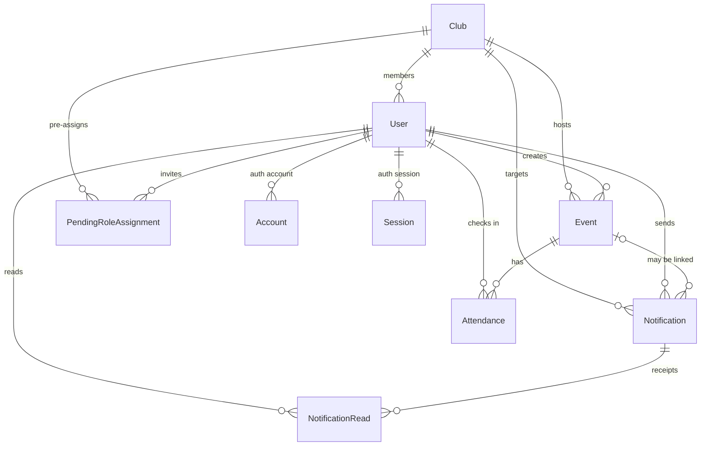

# Data Model

## Overview

The application uses PostgreSQL through Prisma. The schema and migrations live in `prisma/`, and IDs are generated by
Prisma.

Some rules are enforced by the database: unique emails, unique club names, foreign keys, and one read receipt per user
per notification. Other rules involve more than one field or row and are enforced by the application: audience and club
consistency, external-email approval, and blocking club deletion while the club is still in use.

## Main relationships

Most relationships are optional in practice. A user may have no club. An event may belong to a club or to the whole
organisation. A notification is either organisation-wide or club-scoped, and it may also point at an event.

## Main records

### Users and invitations

A user is the local account created on first successful sign-in. It stores the email identity, display details, role,
active status, optional club, and whether an external address was approved.

Users are not deleted by the application. Deactivation is the supported way to revoke access, and it keeps the person's
history and references intact.

A pending invitation stores the intended role, optional club, external-email decision, and who created it. It exists
before the account does and is consumed only when a new user is created.

### Clubs

A club is the scoping unit for members, events, and club notifications. It has a full name and an optional short name.
Both are unique regardless of letter case.

A club can be deleted only when it has no members, events, or notifications. Pending invitations are not part of that
blocking check; their club reference is cleared if the club is removed.

### Events and attendance

An event describes something happening at a place and time. It has a title, optional description, venue, start and
optional end time, an optional club, and the user who created it.

Attendance records a check-in: the event, the user, a check-in time, and a required photo reference. It is not a
registration or RSVP, and the application does not create attendance rows outside the seed data yet.

### Notifications and reads

A notification stores its title, body, audience, author, creation time, optional club, and optional event link. The
database does not enforce that a club audience has a club and an organisation-wide audience does not; the application
schema does.

A read receipt links one notification to one user. Marking a notification read is an upsert, so repeated opens do not
create duplicates.

### Authentication tables

The Auth.js adapter tables link local users to Google accounts and support the standard authentication flow. The
application uses session tokens rather than database session rows for authorization, but the adapter schema remains
intact.

## Rules and constraints

- Email addresses are unique, and the application normalises them to lowercase before storing or looking them up.
- Pending invitation emails are unique, so inviting the same address again updates the existing record.
- Club names and short names are unique regardless of letter case.
- A user belongs to at most one club.
- A user can have at most one attendance record per event.
- A user can have at most one read receipt per notification.
- Deleting a club clears the club reference on related records; the application normally blocks the deletion first.
- Deleting an event clears the event link on related notifications.
- Records that reference a user or notification keep that reference protected by a foreign key.

## Record lifecycles

**Invitation.** An admin creates a pending record. On the person's first sign-in, the account is created from that
record and the pending record is removed. Re-inviting an existing user does not update the existing account.

**Access removal.** An account is deactivated rather than deleted. It can no longer sign in or use existing sessions,
and reactivation restores the same role and club.

**Club deletion.** The application checks members, events, and notifications first. If the club is unused, it is deleted;
pending invitations lose their club reference.

**Read state.** Opening a notification creates or updates the user's read receipt. The feed uses those receipts to show
read and unread items.

## Event groundwork

The `Event` and `Attendance` models and their seed data are preparation for the next phase. There are no event routes,
actions, permissions, or UI yet. The schema does not currently model capacity, registration deadlines, event status,
visibility, waitlists, or a registration state such as registered or cancelled.

`Attendance` answers "who checked in?", not "who said they were coming?". A future registration feature will need its
own model or a deliberate decision to extend attendance. [ROADMAP.md](./ROADMAP.md) lists that and the other open
questions.

## What is not modelled

There is no separate club membership table; the user's club field is the whole membership model. There is no
registration or RSVP record, no soft-delete flag, no audit log, and no change history. Event permissions do not exist
because there are no event actions yet.

Dates are stored as timestamps and displayed in the configured application timezone, so server and browser rendering
agree.
